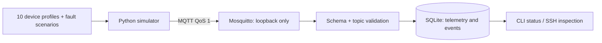
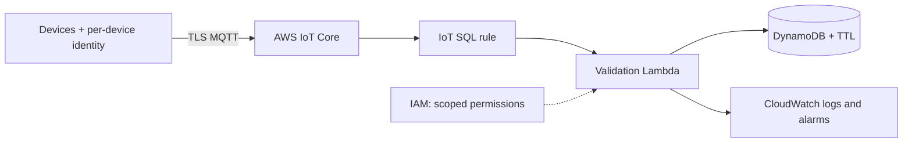

# IoT Telemetry Platform

[](https://github.com/soffianchow/iot-telemetry-platform/actions/workflows/validate.yml)

A hardware-free IoT operations reference platform: ten virtual devices, MQTT ingestion,
validated telemetry, durable local processing, failure injection and modular AWS IaC.
The same device contract can represent agriculture, manufacturing or facilities.
Soil and irrigation fields demonstrate one asset profile, rather than restrict the platform.

**Phase 1: local implementation and AWS preparation. No AWS resources deployed.**



Future AWS target, scaffolded but unprovisioned:



## Run locally

Requires Docker Desktop with Compose; Python 3.11 and uv for host development;
Terraform 1.x matching the constraint in infra/terraform for offline validation.

```sh
make setup
make test
make up
make status
docker compose logs -f --tail=30 simulator processor
```

Broker is bound to `127.0.0.1:1883`; anonymous MQTT is deliberately restricted to local
lab access. Containers share a private Compose network. Do not publish this broker
on a LAN or the internet. SQLite lives in the named `telemetry` volume. Run `make down`
to stop; the volume survives. `docker compose down -v` deliberately deletes lab data.
A Docker Desktop restart or sleeping Mac pauses availability.

```sh
# Containerized unit + actual MQTT integration tests (isolated Compose project on port 18883)
make integration
# Validate infrastructure without AWS authentication or deployment
make terraform
# Host alternative: start broker only, then use two terminals
# docker compose up -d broker
# uv run python -m iot_ops consume --db data/telemetry.db
# uv run python -m iot_ops simulate --config config/devices.json
```

If port 1883 is occupied: `MQTT_PORT=1884 docker compose up -d --build`.
Container-to-container traffic still uses port 1883. Host tools then need `MQTT_PORT=1884`.

## Evidence and navigation

See the [documentation index](docs/INDEX.md), [architecture](docs/ARCHITECTURE.md),
[engineering decisions](docs/ENGINEERING_DECISIONS.md), [AWS design](docs/AWS.md),
[validation results](docs/VALIDATION.md), and [roadmap](docs/ROADMAP.md).

CI runs Python tests, Docker/MQTT integration, and Terraform formatting/validation.
No workflow has AWS credentials or applies Terraform. The AWS configuration has not
been deployed; local verification does not establish production readiness.
