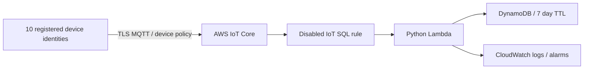

# AWS preparation — Phase 1, never deployed

This directory prepares the future serverless ingestion path. Phase 1 uses local MQTT and SQLite. No AWS credentials, certificates, state backend, endpoint lookups, account queries, plans, or provisioning are needed. `terraform init -backend=false` downloads provider plugins; `terraform validate` checks configuration locally. These commands do not prove deployment permissions or live service behavior.



## Modules and boundaries

| Module | Responsibility | Security and operating decision |
|---|---|---|
| `iot` | Thing type, ten things, one publish policy per device | Explicit client ID and telemetry topic; requires an attached Thing identity; no wildcard publish or command access |
| `rules` | `iot-ops/devices/+/telemetry` SQL routing | Disabled by default; broker topic supplies authoritative `source_device_id` |
| `lambda` | Validate shared JSON contract, conditional writes | Rule ARN + account restrict invocation; rejects topic/body mismatches and unregistered IDs; reserved concurrency 2 |
| `dynamodb` | Device partition key and timestamp/sequence sort key | On-demand billing; AWS-managed encryption; deletion protection plus Terraform `prevent_destroy`; TTL |
| `iam` | Lambda execution role | Only PutItem on its table and stream writes on its existing log group |
| `monitoring` | Seven-day log retention; Errors, Throttles, AsyncEventsDropped, DynamoDB SystemErrors alarms | No notification recipients are configured; inspect alarms manually in a later deployed phase |

There are no device certificates, private keys, principal attachments, command topics, wildcard IAM resources, VPCs, NAT gateways, EC2 instances, or public HTTP endpoints. Device credentials must be individually provisioned in a future approved phase. Merely registering a Thing does not authenticate a device. The default account ID is an inert placeholder; it must be explicitly replaced before a separately authorized cloud phase.

## Validation and packaging

```sh
terraform -chdir=infra/terraform fmt -check -recursive
terraform -chdir=infra/terraform init -backend=false -input=false
terraform -chdir=infra/terraform validate
python -m pytest infra/terraform/modules/lambda/test_handler.py
python infra/terraform/build_lambda.py
```

Run Python commands inside the project virtual environment (Python 3.11+). The build supports either pip or uv.

The build command prepares `.terraform/lambda-package/`, ignored by Git. It copies the exact shared `src/iot_ops/validation.py`, its packaged schema, and the canonical schema and installs `jsonschema` with Linux ARM64 wheels for Python 3.12. This preserves schema paths and avoids shipping macOS native extensions. Build before any future archive/plan operation; it is unnecessary for `terraform validate`. The archive provider packages this directory. The Lambda runtime supplies boto3; pin and package the SDK before production for fully repeatable SDK behavior. The direct `jsonschema` dependency is pinned; transitive wheel versions are not yet frozen with hashes. CI unit tests use the local Python environment. The packaged handler and shared validator were also imported successfully in a Linux ARM64 Python 3.12 container without AWS access. Repeat this smoke check before future deployment.

## Reliability, cost, and limitations

MQTT QoS 1 and asynchronous Lambda delivery can repeat events. A conditional PutItem makes the device + UTC timestamp + sequence identity idempotent; duplicate delivery succeeds without overwriting data or renewing retention. Errors other than duplicates propagate for AWS retries. Retention derives from the event time; old offline telemetry may already be expired on arrival. DynamoDB TTL deletion is asynchronous and may take days; applications must exclude expired rows. A device reboot that resets sequence still has a distinct timestamp; conflicting bodies with the same identity are treated as duplicates.

Lambda logs device IDs and sequence, not complete telemetry. Shared validation rejects malformed readings and inconsistent quality flags. Invalid messages raise function errors and can consume retry capacity: a durable rejected-message destination is future work. Rule action failures currently lack an error action; Lambda retries are bounded to two attempts and one-hour event age, with no dead-letter destination. A later cloud phase must add replay storage and notifications before claiming production durability. Infrastructure checks do not test regional quotas, provider API authorization, service policy propagation, or end-to-end AWS delivery.

On-demand DynamoDB, 128 MB ARM64 Lambda, low concurrency, and seven-day retention reduce idle cost. They do not impose a hard spending cap: IoT messages, rule actions, Lambda requests/duration, DynamoDB operations/storage and CloudWatch alarms/logs are billable when deployed. Ten devices every five seconds produce about 5.18 million messages per 30-day month. Do not assume free-tier eligibility. Before future deployment choose the sampling interval, estimate current regional pricing, add a budget and usage alarms, and review retention. DynamoDB point-in-time recovery is deliberately disabled to limit lab cost; this trades away point-in-time recovery. Future production design should enable it and exercise restores. AWS-managed encryption is the lab default; a customer-managed KMS key would add permissions, operations, and cost.

Terraform state is local and ignored only for preparation. A future team deployment needs a separately managed encrypted, versioned state backend with locking and tightly scoped access. Never put state, device keys, or credentials into Git. Phase 1 has no apply workflow.

## Primary references

- [AWS IoT publish and subscribe policy examples](https://docs.aws.amazon.com/iot/latest/developerguide/pub-sub-policy.html): client, topic and topicfilter are distinct resources.
- [IoT Lambda rule action](https://docs.aws.amazon.com/iot/latest/developerguide/lambda-rule-action.html): Lambda resource permission authorizes the invoking rule.
- [Lambda asynchronous error handling](https://docs.aws.amazon.com/lambda/latest/dg/invocation-async-error-handling.html): retries and duplicate processing require idempotent consumers.
- [DynamoDB TTL behavior](https://docs.aws.amazon.com/amazondynamodb/latest/developerguide/TTL.html): expiration and physical deletion occur at different times.
- [Terraform IoT topic rule reference](https://registry.terraform.io/providers/hashicorp/aws/latest/docs/resources/iot_topic_rule): SQL and Lambda action configuration.
